# Estudos de JavaScript

<p align="center">
  <picture>
    <source media="(max-width: 767px)" srcset="https://raw.githubusercontent.com/IsaacGomes260653/estudos-javascript/main/.github/banner-mobile.svg">
    
  </picture>
</p>

Meus estudos de lógica de programação com JavaScript, no curso da Alura. É a preparação para voltar ao Dart e seguir para o Flutter.

## Por que lógica antes do Dart

- **A lógica é a mesma em qualquer linguagem.** Variáveis, condições, laços e funções funcionam do mesmo jeito em JavaScript, Dart ou Java. Muda a escrita, não o raciocínio.
- **Base firme primeiro, Dart e Flutter depois.** Com a lógica no automático, sobra cabeça para o que é próprio do Dart (tipos, null safety, classes) e do Flutter (widgets e telas).
- **O JavaScript é uma porta de entrada leve.** Roda direto no navegador, sem instalar nada e sem compilar: escrevo, salvo e vejo o resultado na hora.

## O caminho

**Lógica com JavaScript** (agora, aqui) → **Dart** ([estudos-dart](https://github.com/IsaacGomes260653/estudos-dart)) → **Flutter**

A trilha completa, etapa por etapa, fica no [roadmap de estudos do meu perfil](https://github.com/IsaacGomes260653#roadmap).

## O curso

[Lógica de programação: mergulhe em programação com JavaScript](https://cursos.alura.com.br/course/logica-programacao-mergulhe-programacao-javascript), na [Alura](https://www.alura.com.br).

- [ ] Aula 01: Iniciando com JavaScript
- [ ] Aula 02: Condicionais e concatenação
- [ ] Aula 03: Loops e tentativas
- [ ] Aula 04: Boas práticas de programação
- [ ] Aula 05: Desafio

## Como eu estudo

1. Assisto à aula.
2. Escrevo o código sozinho, sem copiar.
3. Provoco erros de propósito, para entender o que cada mensagem de erro quer dizer.
4. Explico com as minhas palavras, nos comentários do código.
5. Revejo depois, com a cabeça fria.
6. Faço um commit por aula concluída.

## Organização

Uma pasta por curso e, dentro dela, uma pasta por aula:

```text
estudos-javascript/
├── 01-logica-de-programacao/
│   ├── aula-01-iniciando-com-javascript/
│   ├── aula-02-condicionais-e-concatenacao/
│   ├── aula-03-loops-e-tentativas/
│   ├── aula-04-boas-praticas/
│   └── aula-05-desafio/
├── LICENSE
└── README.md
```

As pastas das aulas ficam vazias até eu chegar nelas: o código entra conforme eu estudo.

## Como rodar

**No navegador:** abra o `index.html` da aula (dois cliques no arquivo já resolvem). Os resultados de `console.log` aparecem no console do navegador: <kbd>F12</kbd> → aba **Console**.

**Arquivos `.js` soltos, no terminal**, com o [Node.js](https://nodejs.org) instalado (o `node -v` mostra a versão):

```sh
node arquivo.js
```

## Java × JavaScript

Apesar do nome, são linguagens diferentes:

| | Java | JavaScript |
|---|---|---|
| Roda | na JVM | no navegador e no Node.js |
| Tipagem | estática | dinâmica |
| Tipo conferido | antes de rodar | enquanto roda |
| Uso típico | back-end e Android | sites e Node.js |

A lógica é a mesma nas duas: um `if`, um `for` ou uma função resolvem o mesmo problema, só com outra escrita.

## Certificado

Ainda em andamento. O link do certificado da Alura entra aqui quando eu terminar o curso.

## English summary

My programming logic studies with JavaScript, following the Alura course [Lógica de programação: mergulhe em programação com JavaScript](https://cursos.alura.com.br/course/logica-programacao-mergulhe-programacao-javascript). Logic (variables, conditions, loops and functions) is the same in any language, so I'm building that foundation first, in a light language that runs straight in the browser, before going back to [Dart](https://github.com/IsaacGomes260653/estudos-dart) and moving on to Flutter. There is one folder per course and one folder per lesson; open a lesson's `index.html` in the browser, or run a standalone file with `node file.js`. Comments are in Portuguese.

## Licença · License

[MIT](LICENSE)
